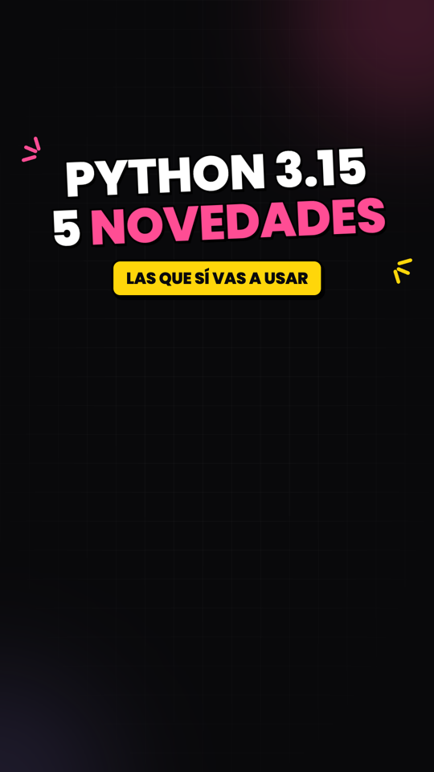
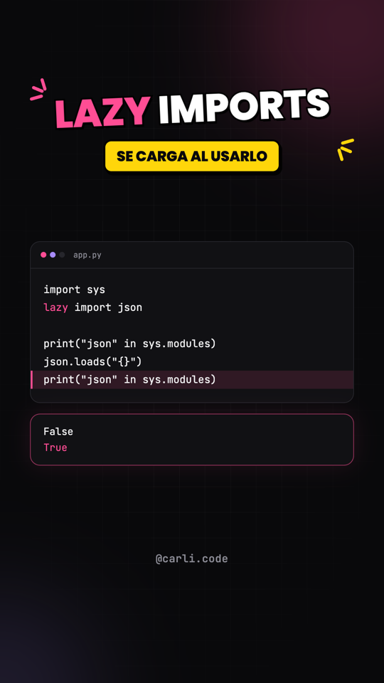
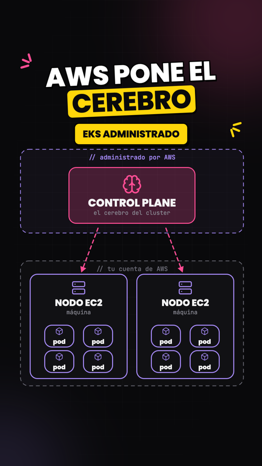
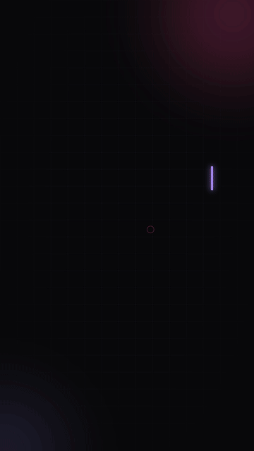
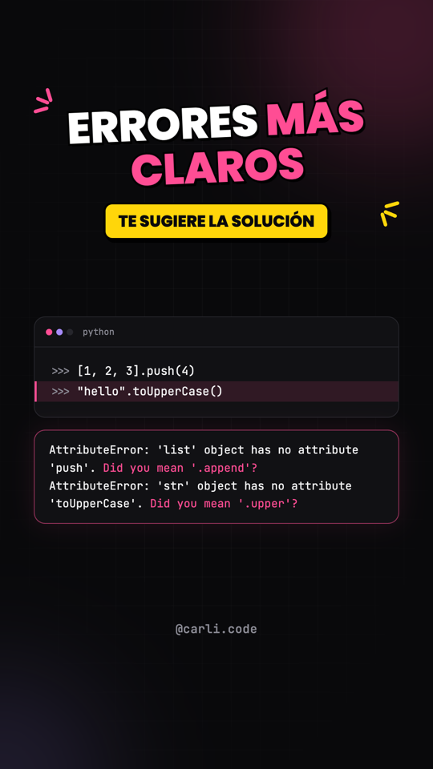
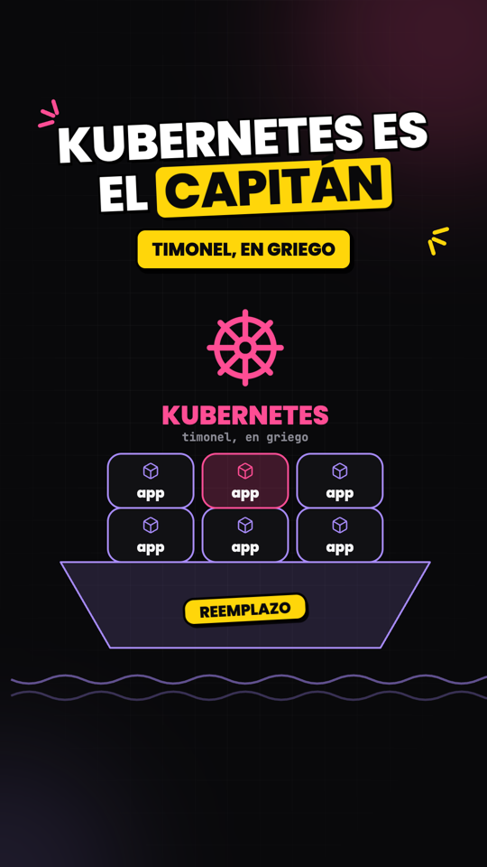
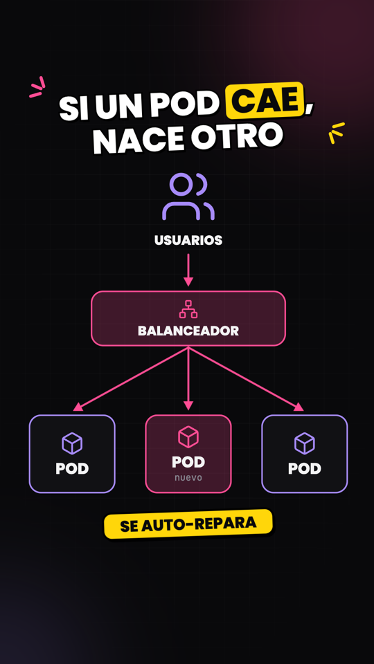
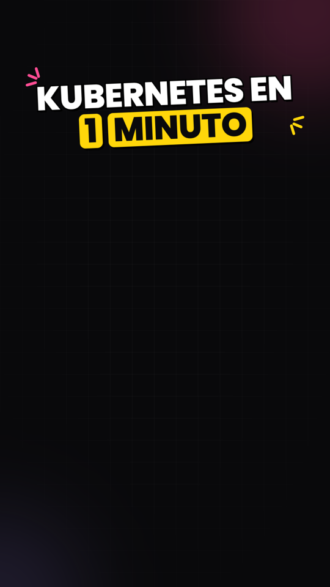

# video-concepto-tech

Una **skill de Claude Code** que convierte un tema de programación o tecnología en un **video vertical (TikTok / Reels) listo para narrar**: slides animados en HTML con código que se escribe solo, resultados resaltados, diagramas que se construyen y una animación de cierre de marca. Tú solo pones la voz (y tu cara, si quieres).

Hecha por [Carli Code (@carli.code)](https://www.tiktok.com/@carli.code). Viene con su marca como ejemplo; cámbiala por la tuya (ver [Personalizar](#personalizar)).

<p align="center">
  
  
  
  
</p>

## Qué hace

Le pides un video ("hazme un video de las novedades de Python 3.15", "un video de Kubernetes en AWS de 70 segundos") y la skill trabaja en **3 pasos con puntos de control**:

1. **Preguntas.** Entiende el tema y te hace 4 preguntas: nivel, ángulo, ejemplos y duración, y cuándo sales en cámara.
2. **Borrador detallado.** Te muestra qué aparece en pantalla **segundo a segundo** y el **guion de tu voz** sincronizado. Iteran hasta que lo apruebes. No se genera nada antes.
3. **Entrega.** Genera los videos y te da todo listo para publicar.

### Dos tipos de video

| Tipo | Para qué | Cómo se ve |
|---|---|---|
| **Código narrado** | Novedades de un lenguaje, un patrón, un truco | Portada con título → cada escena: título + código que se escribe + **resultado resaltado** → cierre de marca |
| **Concepto con tu cara** | Explicar una idea (Kubernetes, una arquitectura…) | Alterna tramos donde **sales tú** (solo queda el título, tú te superpones) con **diagramas grandes** que se construyen (≈60 % gráficos / 40 % tú) |

<p align="center">
  
  
  
  
</p>

### Qué te entrega

Todo queda en una carpeta por video:

```
<tema>/
├── video-completo.mp4        todas las escenas pegadas (1080×1920, 30 fps, sin audio)
├── clips/01-gancho.mp4 …     un clip por escena, para editar
├── copy.txt                  descripción con SEO + 5 hashtags
├── guion.txt                 solo el texto que dices (para pegarlo en el teleprompter)
├── portada.txt / portada.png el título para la portada del video
└── fuente/                   spec.json, video.html y meta.json (para editar y re-exportar)
```

Además te pega el **copy**, el **guion** y el **título de portada** en el chat, en texto plano, listos para copiar.

El video sale **sin audio**: es la base visual. Grabas tu voz mirándolo (o con el guion en el teleprompter) y lo montas en tu editor. Si ya tienes el audio, la skill puede reajustar los tiempos y mezclarlo (`--audio`).

## Requisitos

- [Claude Code](https://claude.com/claude-code)
- Python 3.10+
- Node.js 22+
- ffmpeg
- Google Chrome (se usa en modo headless para grabar cuadro a cuadro)
- Internet (las fuentes Space Grotesk, JetBrains Mono y Poppins vienen de Google Fonts)

En macOS:

```bash
brew install ffmpeg node
```

## Instalación

Clona el repo dentro de tus skills de Claude Code:

```bash
git clone https://github.com/carlicode/video-concepto-tech.git ~/.claude/skills/video-concepto-tech
```

Listo. Claude Code la detecta sola. Ábrelo y pide algo como:

> hazme un video sobre los decoradores en Python

> quiero un video de 70 segundos explicando qué es Docker, enfocado en AWS, donde yo salga un 40 %

## Cómo se usa

1. **Pide el video** con el tema. Si ya sabes la duración o el ángulo, dilo.
2. **Responde las preguntas** (botones de opción en Claude Code).
3. **Revisa el borrador**: tablas con `Seg | En pantalla | Tu voz` y el guion completo. Pide cambios ("el guion debe sonar más hablado", "quita esa escena", "otro ejemplo de código") hasta que te guste.
4. **Aprueba** y espera unos minutos: la skill revisa cada escena en imágenes, exporta el video y los clips y escribe el copy, el guion y la portada.
5. **Graba tu voz** con el guion y monta el video en tu editor (CapCut, Premiere…). En los videos de concepto, pon tu video encima de los clips marcados como tuyos.

Archivos de ejemplo de cada tipo en [`ejemplos/`](ejemplos/).

## Personalizar

La skill viene con la marca de Carli Code. Para usar la tuya:

| Qué | Dónde |
|---|---|
| Handle que sale abajo (`@carli.code`) | campo `"handle"` del spec, o el valor por defecto en `scripts/build_video.py` |
| Palabra del cierre animado (`CARLICODE`) | `word` y `split` en la escena `outro`, o el valor por defecto en `scripts/engine.py` (`L_outro`) |
| Colores (negro, rosa, violeta, amarillo) | variables `:root` al inicio de `assets/tech.css` |
| CTA y estilo del copy | `references/copy-seo.md` |
| Voz y tono del guion | `references/voz.md` (si tienes una skill `guion-tiktok` con tus transcripciones, la usa automáticamente) |
| Carpeta donde se guardan los videos | sección "Dónde se guarda" de `SKILL.md` |
| Reglas de estilo | `SKILL.md` → "Formato por defecto" y `references/style.md` |

## Usar los scripts a mano

No hace falta (Claude los corre por ti), pero existen:

```bash
python3 scripts/build_video.py fuente/spec.json --plan
```

```bash
python3 scripts/build_video.py fuente/spec.json --out fuente
```

```bash
node scripts/export_video.mjs fuente/video.html . --still 3:8
```

```bash
node scripts/export_video.mjs fuente/video.html .
```

```bash
python3 scripts/entregar.py .
```

- `--plan` muestra la duración de cada escena y en qué segundo aparece cada elemento.
- `--out` compila `video.html` (ábrelo en el navegador para ver la vista previa).
- `--still N:seg` saca una imagen de prueba de la escena N.
- La exportación completa genera los clips y el video completo (`--audio voz.m4a` mezcla tu voz).
- `entregar.py` escribe el guion y la portada y verifica todo.

Los tipos de escena (`cover`, `code_focus`, `diagram`, `cara`, `outro`…) y sus campos están en [`references/escenas.md`](references/escenas.md).

## Créditos y licencias

- Código y textos: [MIT](LICENSE) © Carli Code.
- Iconos: [Lucide](https://lucide.dev), licencia ISC ([`assets/icons/LICENSE`](assets/icons/LICENSE)).
- Fuentes: Space Grotesk, JetBrains Mono y Poppins vía Google Fonts (SIL Open Font License).
